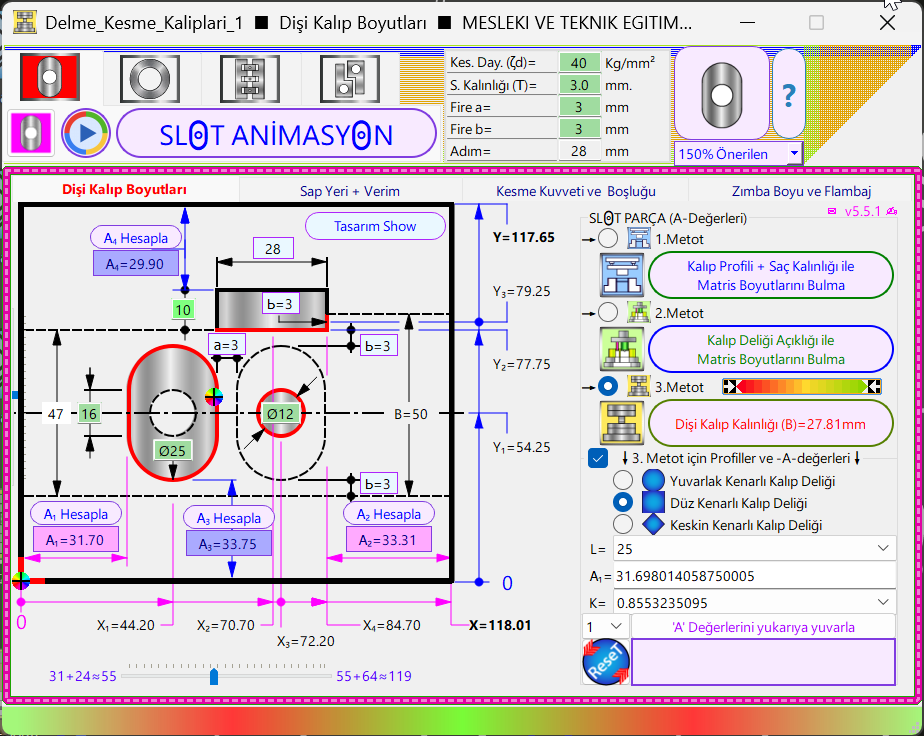
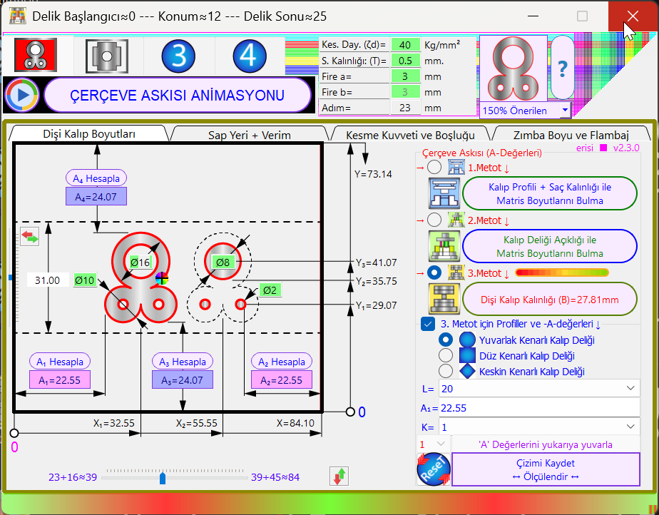

<h1 align="center" id="moduller">🛠️ Saç-Metal Kalıpçılığı Hesaplama Modülleri v1.0.1</h1>

  
  
  

  <b>[TR] Sac Metal Kalıp Mühendisliği Hesaplama Araçları</b> 
  <b>[EN] Sheet Metal Die Engineering Calculation Suite</b>

---

## 📢 ÖNEMLİ DUYURU / IMPORTANT NOTICE
> 📌 **[TR]** Bu depoda bulunan **Sanal Kumpas ve Mikrometre Eğitim Simülatörleri**, daha geniş kitlelere ulaştırılması ve bağımsız geliştirilebilmesi adına **yeni ve özel yuvasına taşınmıştır.** Sanal ölçü aletleri projelerini incelemek ve güncel sürümleri indirmek için lütfen yeni amiral gemisi depomuzu ziyaret edin:  
> 👉 **[Sanal Ölçü Aletleri Eğitimi Deposu (Tıklayın)](https://github.com/alikurtnet/sanal-olcu-aletleri-simulasyonu)**

---

## 📖 Hakkında / About

**[TR]** Bu modül; endüstriyel kalıp tasarımı süreçlerinde kesme kuvvetleri, malzeme verimliliği, şerit yerleşim optimizasyonu ve zımba ömrü hesaplamalarını milimetrik hassasiyetle gerçekleştiren profesyonel araçları içerir. Uygulamalar **Nuitka** ile optimize edilmiş ve **Inno Setup** ile paketlenmiştir. Antivirüs tarayıcılarının şeffaf analiz yapabilmesi için **ana .exe dosyaları sıkıştırılmadan** eklenmiştir.

**[EN]** This module features professional tools for die engineering, focusing on tool life, cutting force, punch clearance, and material efficiency calculations. Applications are optimized with **Nuitka** and bundled via **Inno Setup**. To allow antivirus engines to transparently scan the core logic, **main .exe files are included without compression**.

---

<h2 id="guvenlik">🛡️ Güvenlik Raporları / Security Reports</h2>

| Uygulama / Tool | Dosya Adı / File Name | Rapor / Report |
| :--- | :--- | :--- |
| 🛠️ Kalıp Hesaplama 1 (TR) | `Delme-Kesme-Kaliplari-1-Kur.exe` | [🔍 İncele](https://www.virustotal.com/gui/file/ed6ffdd9c944d959b3756ac1d2a4f9c4932474b3ff38e533e64bd07b4f51361c/detection) |
| 🛠️ Die Calculation 1 (EN) | `Sheet-Metal-Die-Calc-1.exe` | [🔍 İncele](https://www.virustotal.com/gui/file/ed6ffdd9c944d959b3756ac1d2a4f9c4932474b3ff38e533e64bd07b4f51361c/detection) |
| 🛠️ Kalıp Hesaplama 2 (TR) | `Delme-Kesme-Kaliplari-2-Kur.exe` | [🔍 İncele](https://www.virustotal.com/gui/file/ce88cc8608c8f9b1a5247fca7fbc6e5c05f0448131658e49785ab2bd37e3b8ca/detection) |
| 🛠️ Die Calculation 2 (EN) | `Sheet-Metal-Die-Calc-2.exe` | [🔍 İncele](https://www.virustotal.com/gui/file/ce88cc8608c8f9b1a5247fca7fbc6e5c05f0448131658e49785ab2bd37e3b8ca/detection) |

---

## 📥 İndirme Linkleri / Download Links

### 🛠️ Sac-Metal Kalıp Hesaplama Modül-1
* [**İndir (Kurumsal - TR): Delme-Kesme-Kaliplari-1-Kur.exe**](https://github.com/alikurtnet/sheet-metal-die_calc_1/releases/download/v1.0.0/Delme-Kesme-Kaliplari-1-Kur.exe)
* [**Download (Private - EN): Sheet-Metal-Die-Calc-1.exe**](https://github.com/alikurtnet/sheet-metal-die_calc_1/releases/download/v1.0.0/Sheet-Metal-Die-Calc-1.exe)

### 🛠️ Sac-Metal Kalıp Hesaplama Modül-2
* [**İndir (Kurumsal - TR): Delme-Kesme-Kaliplari-2-Kur.exe**](https://github.com/alikurtnet/sheet-metal-die_calc_1/releases/download/v1.0.0/Delme-Kesme-Kaliplari-2-Kur.exe)
* [**Download (Private - EN): Sheet-Metal-Die-Calc-2.exe**](https://github.com/alikurtnet/sheet-metal-die_calc_1/releases/download/v1.0.0/Sheet-Metal-Die-Calc-2.exe)

---

## 🔍 Uygulama Görselleri / Tool Details

  
  

---

Developed by <b>Ali Kurt</b> © 2026

